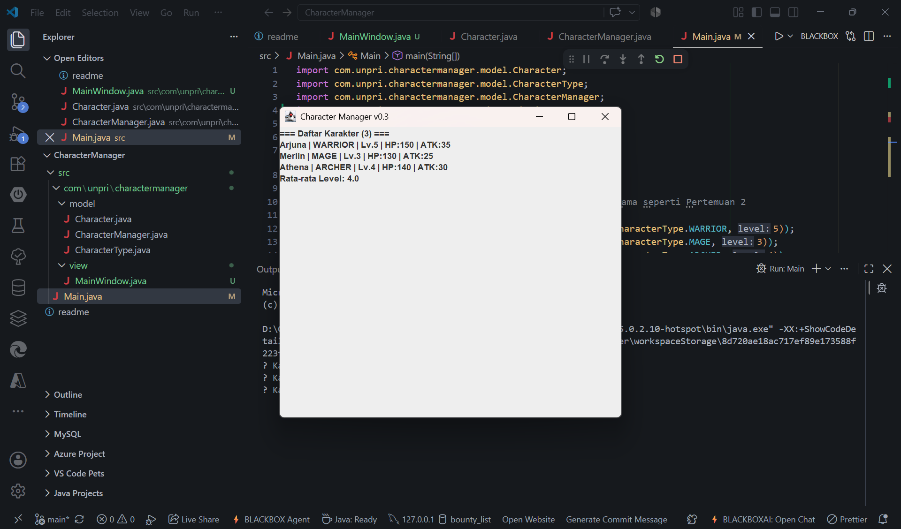

## TP8

### Screenshot MainWindow
**Sebelum data diubah (rata-rata 4.8):**

**Sesudah data diubah (rata-rata 6.8):**

**Penjelasan 3–4 kalimat aliran data Main → CharacterManager → MainWindow, dikaitkan dengan MVC**
Main.java membuat objek CharacterManager lalu mengisinya dengan lima objek Character lewat addCharacter(). Setelah data siap, Main meminta hasil dari Model dengan memanggil manager.getAllCharacters() untuk daftar karakter dan manager.getAverageLevel() untuk statistik, lalu menyerahkannya ke constructor MainWindow. MainWindow hanya menampilkan data tersebut: daftar dibuat lewat loop JLabel, dan rata-rata level hanya diformat dengan String.format, tanpa kalkulasi. Alur ini menerapkan MVC: CharacterManager dan Character adalah Model (data dan logika), MainWindow adalah View (tampilan), dan Main menghubungkan keduanya.

**Daftar karakter baru beserta alasan pemilihan tipe/level**
Lancelot sengaja dibuat level 10 agar data punya karakter kuat, sehingga rata-rata level bergeser dan perubahannya mudah terlihat dan selena sengaja dibuat Level 2 agar ada variasi dan statistik tidak seragam.

**link docx:** https://1drv.ms/w/c/A4248E4F58ABC421/IQBzF9LqI0ZRRoMG0R0p0-BzAT8o7WXMa4l0phWV9nVOhlI?e=Yd9IRZ