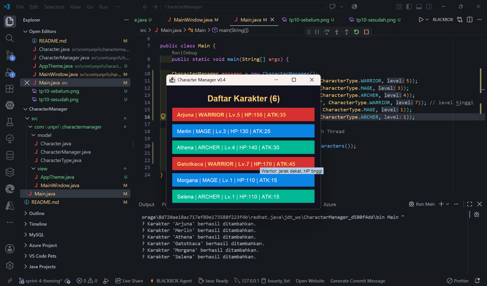
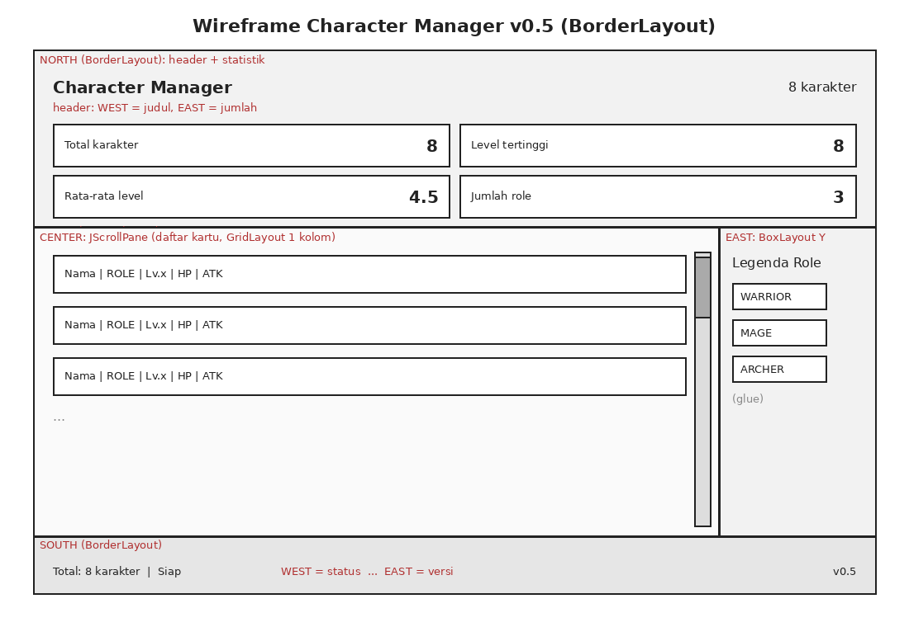
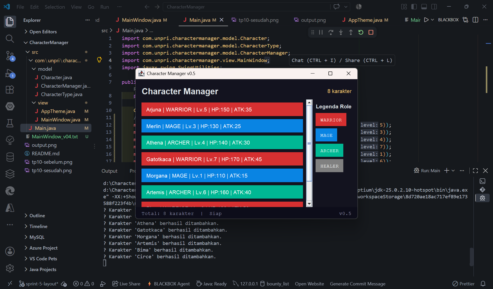
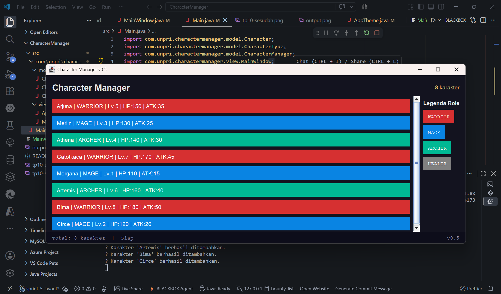
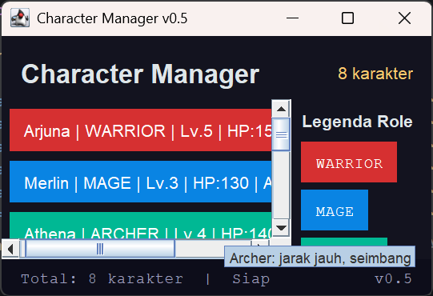

## TP12



### Wireframe


```
+--------------------------------------------+
| Character Manager              8 karakter  |  NORTH (header)
| [Total] [Level tertinggi]                  |  NORTH (statistik 2x2)
| [Rata2] [Jumlah role]                      |
+------------------------------+-------------+
| Daftar karakter (scroll)     | Legenda     |  CENTER + EAST
+------------------------------+-------------+
| Total: 8 karakter | Siap          v0.5     |  SOUTH
+--------------------------------------------+
```

### Screenshot
| Ukuran awal | Dilebarkan | Dikecilkan (scrollbar tampak) |
|---|---|---|
|  |  |  |

### Tabel Pengamatan Resize
| Aksi | Prediksi | Hasil |
|---|---|---|
| Jendela dilebarkan | Daftar dan bar status melebar, legenda tetap | (isi setelah uji) |
| Jendela ditinggikan | Daftar bertambah tinggi, scrollbar hilang jika muat | (isi setelah uji) |
| Jendela dikecilkan ke batas minimum | Scrollbar muncul, berhenti di 560x380 | (isi setelah uji) |

### Struktur Panel Bersarang
Jendela memakai `BorderLayout` dengan empat wilayah. Wilayah NORTH berisi panel pembungkus (`BorderLayout`) yang memuat header dan panel statistik `GridLayout` 2x2, dan tiap sel statistik adalah panel kecil bersarang lagi. Wilayah CENTER berisi `JScrollPane` yang membungkus panel kartu `GridLayout`. Wilayah EAST berisi legenda `BoxLayout`, dan SOUTH berisi bar status `BorderLayout`.

### Alasan Panel Tambahan
Saya memilih `GridLayout` 2x2 karena empat statistik berbobot sama, sehingga sel berukuran seragam dan ikut melebar saat jendela dilebarkan. Saya menolak `FlowLayout` karena sel bisa pindah baris dan bergeser saat jendela dikecilkan, dan `GridBagLayout` karena terlalu rumit untuk 4 sel yang sama besar.

### Bagian D
[Link Google Docs](https://1drv.ms/w/c/A4248E4F58ABC421/IQD_Yqiv7-l9Rac83L94SVj4AbDlXdpiEVYal88tBlBtVs4?e=f6FB0P) 