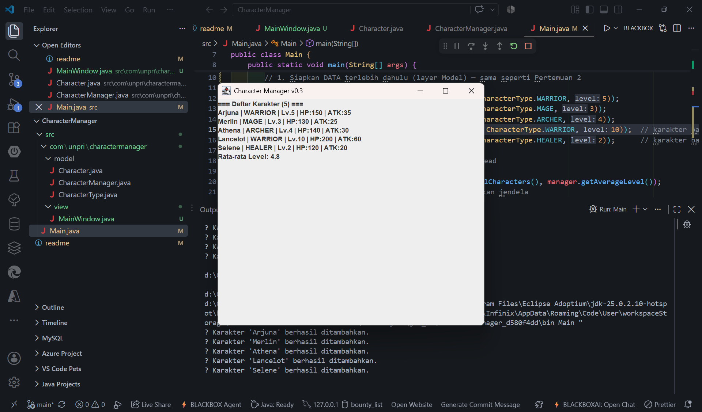
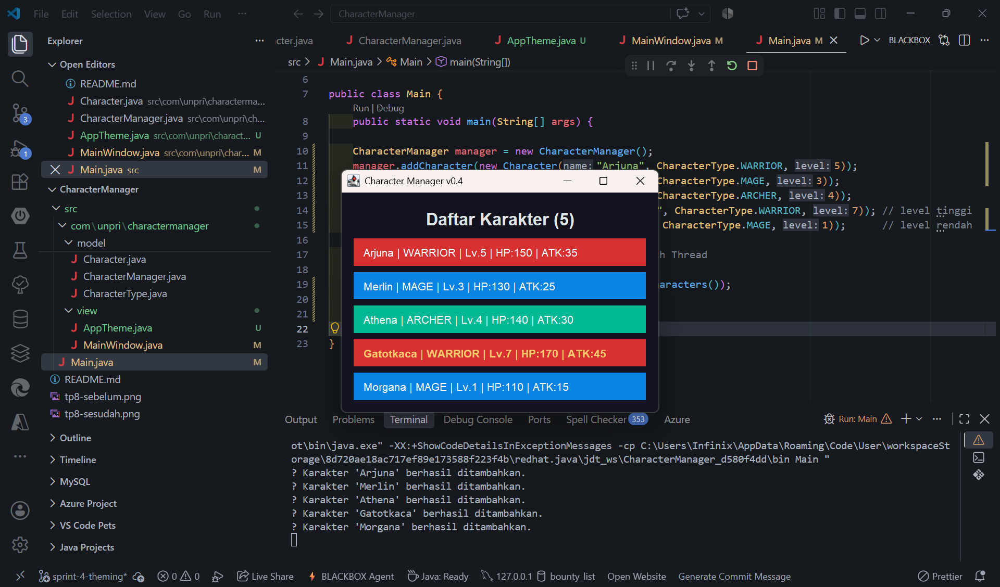

## TP10

### Screenshot MainWindow
**Sebelum data diubah (rata-rata 4.8):**/

**Sesudah data diubah (rata-rata 6.8):**

**Hasil Output**

### Mengapa Warna Disimpan di AppTheme, Bukan di Character

Warna adalah urusan tampilan, sedangkan `Character` adalah Model yang hanya menyimpan data game seperti nama, tipe, level, HP, dan ATK. Jika warna ditaruh di `Character`, Model jadi bergantung pada `java.awt` dan melanggar pemisahan MVC. Dengan memusatkan warna di `AppTheme`, mengganti tema cukup dengan mengubah satu file tanpa menyentuh Model maupun logika game. Arah dependensinya juga tetap satu arah: View boleh membaca Model, tetapi Model tidak mengenal View.

### Dua Properti Tambahan

| Properti | Kode | Alasan |
|---|---|---|
| Tooltip | `lbl.setToolTipText(AppTheme.describe(c.getType()))` | Pemain bisa melihat penjelasan role (misalnya "Warrior: jarak dekat, HP tinggi") saat kursor diarahkan ke kartu, tanpa memenuhi tampilan dengan teks tambahan. Teksnya dipusatkan di `AppTheme.describe()` sehingga mudah diubah. |
| Border | `lbl.setBorder(AppTheme.CARD_BORDER)` | Memberi padding agar teks tidak menempel ke tepi kartu, sehingga kartu lebih rapi dan terbaca. Border bersifat immutable dan disimpan sebagai `static final`, jadi aman dipakai ulang oleh semua kartu. |

**link docx:** https://1drv.ms/w/c/A4248E4F58ABC421/IQCxm3kWh7TbRp7TvdSSF2_ZAeRb_o9CWNseABIAzfXTPGk?e=lIIoLH