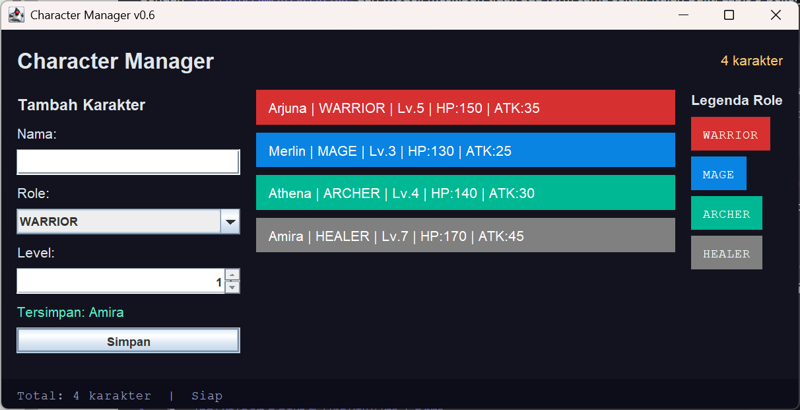
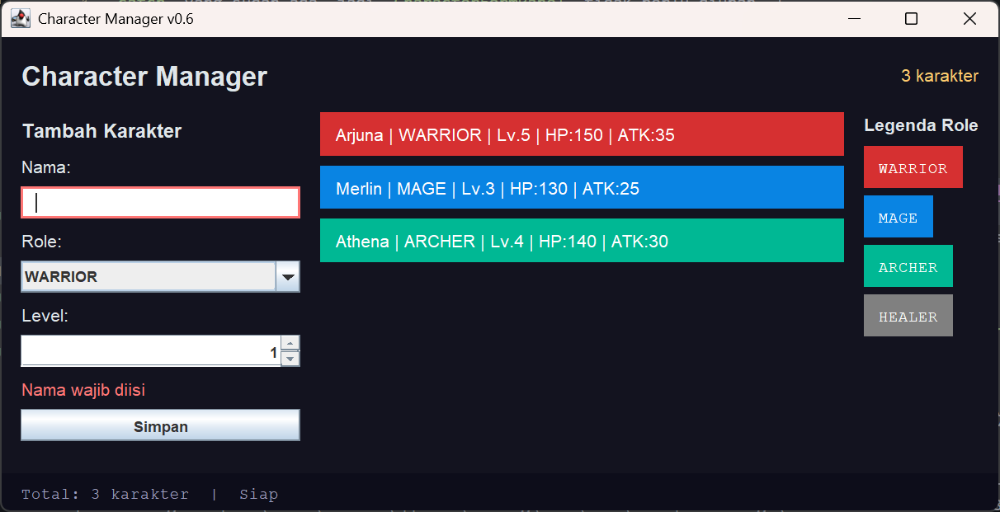
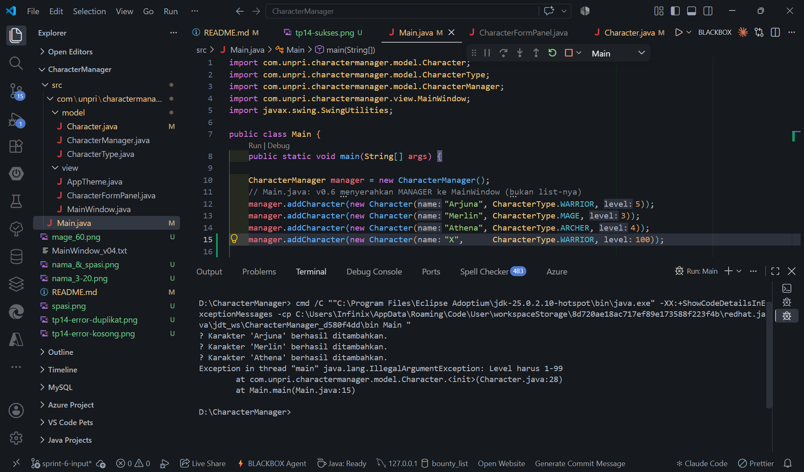

## TP14: Komponen Input & Validasi (Character Manager v0.6)

Di sprint ini akhirnya bisa menerima data dari pengguna, tidak cuma menampilkan karakter di `Main.java`. saya menambahkan form dengan tiga komponen: `JTextField` untuk nama, `JComboBox` untuk role, dan `JSpinner` untuk level (1-99). Validasinya saya bagi tiga lapis. Komponen membatasi pilihan, `validateName()` di View memeriksa nama yang diketik, dan konstruktor `Character` di Model menjaga aturan bisnis.

### Screenshot

**1. Error nama kosong.** Pesan error muncul berwarna merah, field nama diberi border merah, dan kursor kembali ke field itu.

**2. Error nama duplikat.** Muncul pesan "Nama sudah dipakai" saat aku mengetik nama yang sudah ada.

**3. Sukses.** Karakter baru langsung muncul sebagai kartu di daftar, dan ada pesan hijau di form.

### Aturan Validasi Tambahan

| Aturan | Ditaruh di | Alasan |
|---|---|---|
| MAGE tidak boleh level di atas 60 | Model (`Character`) | Aturan ini tetap masuk akal walaupun aplikasi dijalankan tanpa jendela, dan melibatkan dua field sekaligus (role dan level). Pesan errornya tampil di form lewat `catch` yang sudah ada, jadi `CharacterFormPanel` tidak perlu diubah. |
| <<aturan pilihanku yang pertama>> | <<Model / View>> | <<alasanku>> |
| <<aturan pilihanku yang kedua>> | <<Model / View>> | <<alasanku>> |

### Tabel Uji

| No | Input | Hasil diharapkan | Hasil nyata | Lapisan yang menangkap |
|---|---|---|---|---| 
| 1 | Nama dikosongkan | "Nama wajib diisi", border merah, kursor di field nama | | View (kelengkapan) |
| 2 | Nama hanya berisi spasi | Sama seperti kasus 1, karena `trim()` membuang spasinya |  | View (kelengkapan) |
| 3 | `Ab` | "Nama harus 3-20 karakter" |  | View (panjang) |
| 4 | `Arjuna123` | "Nama hanya huruf dan spasi" |  | View (format) |
| 5 | `arjuna` | "Nama sudah dipakai", karena Arjuna sudah ada |  | Model (`isNameTaken`) |
| 6 | Nama dengan 21 huruf | "Nama harus 3-20 karakter" |  | View (panjang) |
| 7 | `Amira`, ARCHER, level 8 | Tersimpan dan kartu baru muncul |  | Sukses |
| 8 | MAGE, level 61 | "Level MAGE maksimal 60 (diminta: 80)" |  | Model (konstruktor `Character`) |
| 9 | Mengetik `100` langsung di spinner, lalu Simpan | Tidak ada karakter level di atas 99 yang masuk | / | Komponen / Model/Komponen (`SpinnerNumberModel`) |

**Catatan hasil uji:**

Hampir semua hasil nyata sesuai dengan harapan, kecuali kasus 9 (level 100 di spinner). Awalnya saya mengira angka 100 akan ditolak dengan pesan error dari Model, atau malah lolos karena ada pesan "Tersimpan: julian". Ternyata yang terjadi berbeda: saat mengetik `500` di kolom spinner lalu menekan Simpan, spinner menolak angka di luar rentang 1-99 dan mengembalikan isinya ke nilai sah terakhir, yaitu 1. Form lalu membaca nilai 1 itu, sehingga karakter `julian` tersimpan dengan Lv.1 (HP:110, ATK:15), bukan Lv.100.

Perbaikan. Pertama, `SpinnerNumberModel(1, 1, 99, 1)` sudah menjadi lapisan pertahanan pertama yang bekerja sebelum data sampai ke Model, sehingga tidak ada karakter dengan level di atas 99 yang pernah masuk ke daftar. Kedua, perilaku ini kurang ramah karena pengguna tidak diberi tahu bahwa angkanya diganti, dan pesan "Tersimpan" tetap muncul. Hasilnya bukan bug yang membahayakan data, tetapi perilaku bawaan komponen.

### Kompromi Sementara

Untuk tombol Simpan, saya memakai `addActionListener` dengan lambda satu baris saja, karena materi event handling baru dibahas lengkap di Pertemuan 9. Form juga masih memanggil `manager.addCharacter()` secara langsung, lalu memberi tahu `MainWindow` lewat `Runnable` supaya daftar disegarkan. View belum rapi karena View seharusnya tidak berurusan langsung dengan data. Jadi kedua hal ini sengaja dibiarkan sederhana dulu supaya fokus tetap di input dan validasi, dan nanti di Pertemuan 9 pemanggilan manager akan dipindahkan ke Controller.

### Link Bagian D

Google Docs: <<https://1drv.ms/w/c/A4248E4F58ABC421/IQBuJ9TmuO9CSqHT6AWzW-_NASrVwYxVKX_y4tfbrAUnajE?e=2mm19D>>